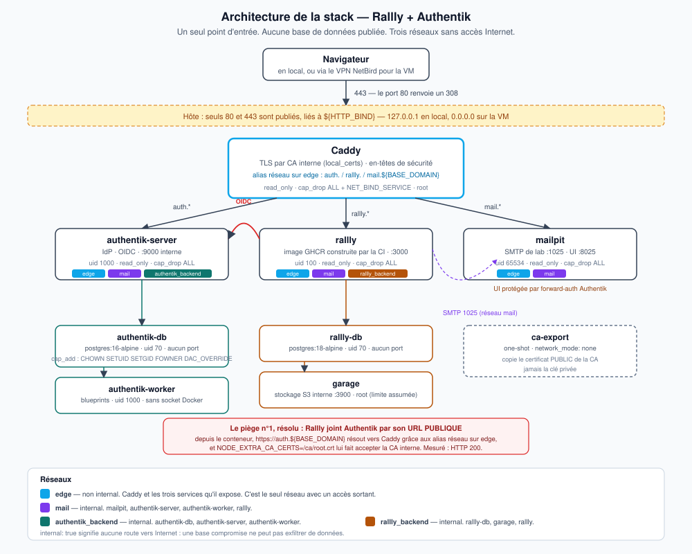

# Architecture



Le schéma est en **SVG versionné** (`docs/img/architecture.svg`) plutôt qu'en PNG
exporté d'un outil externe : il reste lisible à toute échelle, et une modification
de l'infrastructure se relit dans un diff Git.

## 1. Le principe en trois phrases

Un **unique point d'entrée**, Caddy, qui termine le TLS et répartit vers trois
services selon le nom de domaine demandé. **Aucun autre service ne publie de port**
sur l'hôte. Les trois réseaux applicatifs sont `internal: true`, donc **sans aucune
route vers Internet** : une base de données compromise ne peut rien exfiltrer.

## 2. Réseaux

| Réseau | `internal` | Membres | Rôle |
|---|---|---|---|
| `edge` | non | `caddy`, `authentik-server`, `rallly`, `mailpit` | Seul réseau avec accès sortant. Porte les alias DNS de Caddy. |
| `mail` | **oui** | `mailpit`, `authentik-server`, `authentik-worker`, `rallly` | SMTP de lab, port 1025 |
| `authentik_backend` | **oui** | `authentik-db`, `authentik-server`, `authentik-worker` | Accès à la base de l'IdP |
| `rallly_backend` | **oui** | `rallly-db`, `garage`, `rallly` | Base applicative et stockage S3 |

`ca-export` n'est sur **aucun** réseau : il tourne en `network_mode: none`.

Relevé par `docker compose config`, pas recopié du plan.

## 3. Ports

| Port | Où | Lié à |
|---|---|---|
| 80 | hôte | `${HTTP_BIND}` — redirige en **308** vers 443 |
| 443 | hôte | `${HTTP_BIND}` — `127.0.0.1` en local, `0.0.0.0` sur la VM |
| 9000 | interne | `authentik-server` |
| 3000 | interne | `rallly` |
| 8025 / 1025 | interne | `mailpit` (UI / SMTP) |
| 3900 | interne | `garage` (S3) |
| 5432 | interne | `authentik-db`, `rallly-db` |
| 2019 | **loopback du conteneur uniquement** | API d'administration de Caddy, écoute sur `127.0.0.1:2019` |

**Aucune base de données n'est joignable depuis l'hôte ni depuis le réseau.**

## 4. Volumes

| Volume | Monté par | Contenu |
|---|---|---|
| `caddy_data` | `caddy` (rw), `ca-export` (**ro**) | CA interne, certificats émis, clés privées |
| `caddy_config` | `caddy` | configuration auto-générée |
| `ca_public` | `ca-export` (rw), `rallly` (**ro**) | **uniquement** `root.crt`, le certificat public de la CA |
| `authentik_db` | `authentik-db` | données Postgres de l'IdP |
| `rallly_db` | `rallly-db` | données Postgres applicatives |
| `garage_meta`, `garage_data` | `garage` | métadonnées et objets S3 |

La séparation `caddy_data` / `ca_public` est délibérée : Rallly a besoin de **faire
confiance** à la CA, pas de pouvoir **signer** avec elle. Le volume qu'il monte ne
contient que le certificat public, en lecture seule, et `caddy_data` — qui contient
la clé privée — ne lui est jamais exposé.

## 5. Le flux d'une connexion, de bout en bout

Mesuré sur la VM, pas théorique.

1. Le navigateur demande `https://rallly.<domaine>`. Caddy présente un certificat
   signé par sa CA interne et sert l'application.
2. L'utilisateur clique **« Continue with Authentik »**. Rallly génère un `state`
   anti-CSRF, **le dépose dans un cookie**, et redirige vers
   `https://auth.<domaine>/application/o/authorize/?…`.
3. Authentik affiche son *flow* d'authentification. L'identifiant est résolu, puis le
   mot de passe vérifié (`stage: default-authentication-password`).
4. Les *policies* décident : `alice` (groupe `rallly-users`) et `admin`
   (`rallly-admins`) sont autorisés, `bob` (`sans-acces`) est refusé.
5. Authentik journalise `authorize_application` et redirige vers
   `https://rallly.<domaine>/api/auth/callback/oidc?code=…&state=…`.
6. Rallly compare le `state` reçu à celui de son cookie. **S'ils diffèrent, la
   connexion est refusée** (`state_security_mismatch`).
7. Rallly échange le `code` contre des jetons **en appelant Authentik par son URL
   publique**, depuis l'intérieur du réseau Docker — voir §6.
8. La session est créée. Les e-mails émis au passage partent vers `mailpit` sur le
   réseau `mail`.

### Piège de démonstration, rencontré pour de vrai
Le `state` de l'étape 2 est à **usage unique et de courte durée**. Réutiliser une URL
d'autorisation déjà ouverte — un onglet laissé en place, un lien repris de
l'historique — produit l'erreur de l'étape 6, qui ressemble à une panne alors que
c'est la protection anti-CSRF qui fonctionne. **Toujours repartir du bouton de
connexion.**

## 6. Le piège n°1 : Rallly doit joindre Authentik par son URL publique

À l'étape 7 ci-dessus, le serveur Rallly télécharge la découverte OIDC sur
`https://auth.<domaine>/…`. Deux problèmes se posent, et deux mécanismes les règlent.

**Le nom ne résoudrait pas.** Dans un conteneur, `auth.localhost` pointerait vers le
conteneur lui-même. Caddy porte donc des **alias réseau** sur `edge` :
`auth.${BASE_DOMAIN}`, `rallly.${BASE_DOMAIN}` et `mail.${BASE_DOMAIN}`. Depuis
Rallly, le nom public résout vers Caddy.

**Le certificat ne serait pas reconnu.** Il est signé par la CA interne, absente du
magasin de confiance de Node. Le service `ca-export` copie le certificat **public**
de la CA dans le volume `ca_public`, que Rallly monte en lecture seule, et
`NODE_EXTRA_CA_CERTS=/ca/root.crt` lui dit de l'accepter.

Vérification, depuis l'intérieur du conteneur :

```bash
docker compose exec rallly node -e \
  "fetch(process.env.OIDC_DISCOVERY_URL).then(r=>console.log(r.status))"
# -> 200, en local comme sur la VM
```

## 7. Choix de conception, et ce qu'ils coûtent

| Choix | Raison | Contrepartie assumée |
|---|---|---|
| **CA interne Caddy** (`local_certs`) partout | La VM n'est pas publique, Let's Encrypt est impossible sans DNS public | Avertissement du navigateur, à accepter ou à lever en important la CA |
| **Trois fichiers Compose** chargés par `COMPOSE_FILE` | Chacun édite le sien, pas de conflit de merge à trois | Il faut lancer les commandes depuis la racine, là où est le `.env` |
| **Volumes et réseaux déclarés dans `compose.yml` seul** | Une seule source de vérité | Les fichiers de P2 et P3 les utilisent sans pouvoir les redéclarer |
| **Mailpit comme SMTP** | Aucun envoi réel, démonstration des e-mails possible | Ce n'est pas un vrai serveur de messagerie, il accepte n'importe quels identifiants |
| **Garage plutôt que MinIO** | Configuration officielle de `rallly-selfhosted`, image légère | Tourne en root, voir `docs/securite.md` §4.2 |
| **`sslip.io` sur la VM** | Encode l'IP dans le nom, donc zéro DNS à configurer | Dépend d'un service tiers, et un résolveur anti-rebinding peut le filtrer |

## 8. Local et VM : une seule différence

Les trois fichiers Compose, le Caddyfile et les blueprints sont **identiques** dans
les deux environnements. Seul le `.env` change :

| Variable | Local | VM |
|---|---|---|
| `BASE_DOMAIN` | `localhost` | `10-2-192-3.sslip.io` |
| `HTTP_BIND` | `127.0.0.1` | `0.0.0.0` |
| `RALLLY_IMAGE` | image upstream ou `rallly-local:dev` | image GHCR de la CI |

Le détail du déploiement, les pièges de la plateforme Énov et le test de résilience
sont dans [`vm-enov.md`](vm-enov.md). Le durcissement et le scan de vulnérabilités
sont dans [`securite.md`](securite.md).
