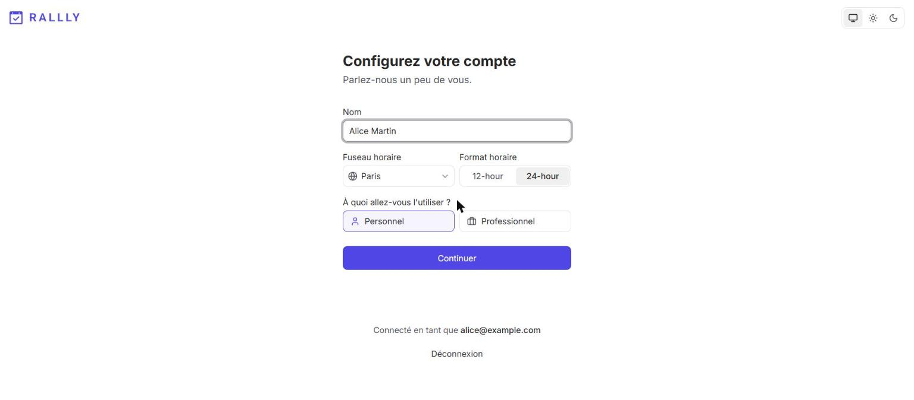
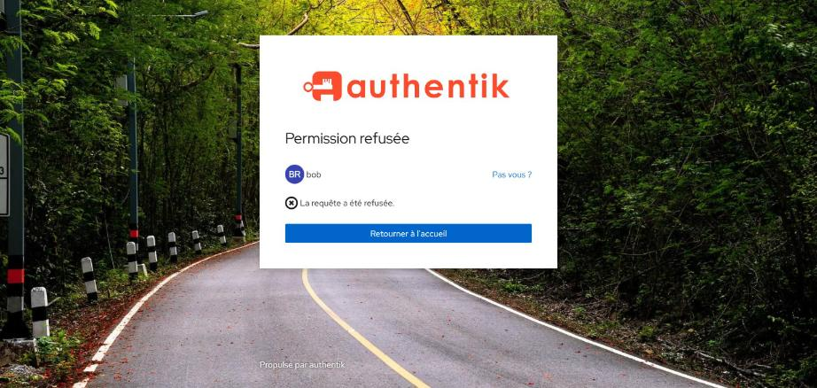
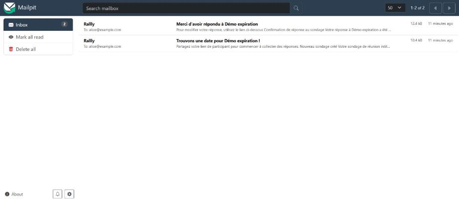

# Authentik — identité, SSO, policies, invitation

Responsable : P2. Fichiers : `compose.authentik.yml`, `authentik/blueprints/`, bloc `mail.*`
de `proxy/Caddyfile`.

## 1. Rôle dans l'architecture

Authentik est le fournisseur d'identité (IdP) de la stack :

- **SSO OIDC** pour Rallly (« Se connecter avec Authentik ») ;
- **forward-auth** devant Mailpit (`https://mail.<BASE_DOMAIN>`), réservé aux admins ;
- **enrôlement sur invitation** pour les utilisateurs externes.

Il n'est joignable que par Caddy (`https://auth.<BASE_DOMAIN>`), aucun port n'est publié.

| Service | Image | Réseaux |
|---|---|---|
| `authentik-server` | `ghcr.io/goauthentik/server:${AUTHENTIK_TAG}` | `edge`, `authentik_backend`, `mail` |
| `authentik-worker` | idem, `command: worker` | `authentik_backend`, `mail` |
| `authentik-db` | `postgres:16-alpine` | `authentik_backend` (interne) |

Version : **2026.5.8**, épinglée dans `.env.example` (`AUTHENTIK_TAG`). La branche 2026.8 existe,
mais on reste sur 2026.5 : changer de version mineure en cours de projet est un risque inutile.
Depuis 2025.10, Authentik n'utilise plus Redis : PostgreSQL + server + worker suffisent.

### Écarts avec le compose officiel (2026.5.8)

| Officiel | Chez nous | Pourquoi |
|---|---|---|
| Worker en `user: root` + `/var/run/docker.sock` | Ni root ni socket | On n'utilise pas d'outpost géré par Docker (l'outpost **embarqué** suffit) : accès au socket = root sur l'hôte |
| Ports `9000` / `9443` publiés | Aucun port | Tout passe par Caddy (TLS, en-têtes de sécurité) |
| `env_file: .env` | Variables listées explicitement | Chaque conteneur ne reçoit que ce dont il a besoin |
| `./data`, `./certs`, `./custom-templates` en bind mount | Aucun de ces montages | Pas de média uploadé, ni certificat, ni template personnalisé : toute la config est dans les blueprints. Un volume `/data` partagé par server et worker provoquait en plus une course à l'initialisation (`failed to create symlink …/media: file exists`) |
| — | `./authentik/blueprints:/blueprints/custom:ro` sur le worker | Configuration as code (voir §5) |
| — | `cap_drop: [ALL]`, `no-new-privileges` | Durcissement |
| Healthcheck Postgres toutes les 30 s | 10 s | Démarrage plus rapide de la stack |
| `shm_size: 512mb` | Conservé | Requis par le worker |

Télémétrie coupée : `AUTHENTIK_ERROR_REPORTING__ENABLED=false`,
`AUTHENTIK_DISABLE_STARTUP_ANALYTICS=true`, `AUTHENTIK_DISABLE_UPDATE_CHECK=true`.
Les e-mails partent vers Mailpit (`mailpit:1025`, réseau interne `mail`).

## 2. SSO OIDC vers Rallly

| Élément | Valeur |
|---|---|
| Provider | `rallly` (OAuth2/OpenID, client confidentiel) |
| Application | `Rallly`, slug `rallly` |
| Découverte | `https://auth.<BASE_DOMAIN>/application/o/rallly/.well-known/openid-configuration` |
| Redirect URIs (strictes) | `https://rallly.<BASE_DOMAIN>/api/auth/callback/oidc`, `http://localhost:3000/api/auth/callback/oidc` (dev) |
| Grants | `authorization_code`, `refresh_token` |
| Scopes | `openid`, `email`, `profile` |
| Signature | `authentik Self-signed Certificate` → jetons **RS256** |
| Client ID / secret | `RALLLY_OIDC_CLIENT_ID` / `RALLLY_OIDC_CLIENT_SECRET` du `.env` |

Le client secret est lu **depuis le même `.env`** par le blueprint (worker) et par Rallly :
il n'y a jamais rien à copier-coller entre les deux.

Côté Rallly (`compose.rallly.yml`, P3) : `OIDC_NAME=Authentik`, `OIDC_DISCOVERY_URL`,
`OIDC_CLIENT_ID`, `OIDC_CLIENT_SECRET`, `INITIAL_ADMIN_EMAIL=${RALLLY_ADMIN_EMAIL}`. Le serveur
Rallly joint `auth.<BASE_DOMAIN>` grâce aux alias réseau de Caddy et fait confiance à la CA
interne via `NODE_EXTRA_CA_CERTS` (voir `docs/architecture.md`).

Rallly (better-auth) démarre le login par `POST /api/better-auth/sign-in/oauth2`
(`providerId: oidc`). Au premier login, le compte Rallly est créé avec le nom et l'e-mail
fournis par Authentik.

**Admin Rallly** : `INITIAL_ADMIN_EMAIL` ne donne pas le rôle automatiquement. Au premier
passage, `admin` ouvre `https://rallly.<domaine>/control-panel` et **réclame** le rôle
administrateur. Les connexions suivantes l'ont déjà.

Résultats vérifiés (parcours complet, local) :

| Compte | Résultat |
|---|---|
| alice | Session Rallly « Alice Martin » / `alice@example.com` |
| admin | Session Rallly « Admin Rallly », rôle admin à réclamer dans le Control Panel |
| bob | Bloqué sur Authentik (« Permission denied »), aucune session Rallly |



## 3. Groupes et policies

| Groupe | Rallly | Mailpit | Comptes |
|---|---|---|---|
| `rallly-admins` | ✅ | ✅ | `admin` |
| `rallly-users` | ✅ | ❌ | `alice` |
| `externes` | ✅ | ❌ | invités (`carol`) |
| `sans-acces` | ❌ | ❌ | `bob` |

Chaque droit est un **policy binding de groupe** sur l'application. L'application Rallly est
en `policy_engine_mode: any` : l'accès est accordé si **au moins un** binding passe. Dès qu'une
application a des bindings, un utilisateur qui n'en satisfait aucun reçoit la page
« Permission denied » d'Authentik **avant** qu'un code OIDC soit émis. C'est le cas de bob.

Mailpit n'a qu'un binding (`rallly-admins`) : c'est un **second droit, distinct** du premier.
alice entre dans Rallly mais pas dans Mailpit.

### Mailpit en forward-auth

```
navigateur ──► Caddy (mail.*) ──forward_auth──► authentik-server:9000/outpost.goauthentik.io/auth/caddy
                     │                                  │ 200 → on laisse passer
                     │                                  │ 302 → login Authentik
                     └──► mailpit:8025
```

- Provider proxy `mailpit-forward-auth`, mode `forward_single`, hôte externe
  `https://mail.<BASE_DOMAIN>`.
- Il est servi par l'**outpost embarqué** (intégré à `authentik-server`), configuré lui aussi
  par blueprint : provider attaché, `authentik_host=https://auth.<BASE_DOMAIN>`,
  `authentik_host_insecure=true` (CA interne).
- La config de l'outpost est un JSON **remplacé en bloc** par le blueprint. On y recopie donc
  toutes les clés par défaut de la version installée. Après une montée de version, il faut
  comparer avec la config par défaut, sinon des clés pourraient disparaître.

| bob (`sans-acces`) refusé sur Rallly | admin (`rallly-admins`) dans Mailpit |
|---|---|
|  |  |

## 4. Invitation d'un externe

Blueprint `20-invitation.yaml`, flow `rallly-invitation` (désignation *enrollment*,
réservé aux utilisateurs non connectés) :

| Ordre | Stage | Rôle |
|---|---|---|
| 0 | `rallly-invitation-invitation` | Exige un jeton valide (`continue_flow_without_invitation: false`) |
| 10 | `rallly-invitation-prompt` | Nom d'utilisateur, mot de passe ×2, nom, e-mail |
| 20 | `rallly-invitation-user-write` | Crée **toujours** un nouvel utilisateur, type `external`, chemin `users/externes`, groupe **`externes`** |
| 100 | `rallly-invitation-user-login` | Ouvre la session |

Il dérive de l'exemple officiel `/blueprints/example/flows-invitation-enrollment.yaml`, dont
on n'a gardé que la variante « external ». Une entrée `metaapplyblueprint` impose que le
blueprint `Rallly stack` soit appliqué d'abord, pour que le groupe `externes` existe.

### Parcours de démo (carol)

1. `akadmin` → **Directory → Invitations → Create** : flow `rallly-invitation`, *Single use*,
   expiration J+7, *Fixed data* : `{"email": "carol@example.org"}`.
2. Copier le lien `https://auth.<domaine>/if/flow/rallly-invitation/?itoken=…`.
3. Fenêtre privée : carol ouvre le lien, choisit son identifiant et son mot de passe → elle est connectée.
4. `https://rallly.<domaine>` → « Se connecter avec Authentik » → accès accordé (groupe `externes`).
5. Rouvrir le même lien : « Invalid invite/invite not found » (usage unique). Sans jeton :
   même refus.

## 5. Blueprints : configuration as code

| Fichier | Contenu |
|---|---|
| `authentik/blueprints/10-rallly-stack.yaml` | Groupes, comptes de démo, provider + application Rallly, policies, provider + application Mailpit, outpost embarqué |
| `authentik/blueprints/20-invitation.yaml` | Flow et stages d'enrôlement sur invitation |

- Le dossier est monté en lecture seule dans le **worker** sur `/blueprints/custom`. Le worker
  découvre les fichiers au démarrage puis périodiquement, et les applique.
- Les valeurs propres à l'environnement viennent de l'`environment` du worker via `!Env` :
  `BASE_DOMAIN`, `RALLLY_OIDC_CLIENT_ID`, `RALLLY_OIDC_CLIENT_SECRET`, `DEMO_PASSWORD`,
  `RALLLY_ADMIN_EMAIL`. Le même fichier sert donc en local et sur la VM.
- Les comptes sont en `state: created` : créés une fois, jamais écrasés ensuite (un mot de
  passe changé dans l'UI le reste).
- Résultat : `./stack.sh reset && ./stack.sh up` recrée tout **sans un clic**.

Vérifier l'état : **Customization → Blueprints** (statut `successful` + logs), ou :

```bash
MSYS_NO_PATHCONV=1 docker compose exec authentik-worker ak shell -c \
  "from authentik.blueprints.models import BlueprintInstance as B; [print(b.name, b.status) for b in B.objects.filter(path__startswith='custom')]"
```

Appliquer tout de suite après une modification (sans attendre la découverte périodique) :

```bash
MSYS_NO_PATHCONV=1 docker compose exec authentik-worker ak apply_blueprint custom/10-rallly-stack.yaml
```

Récupérer la syntaxe exacte d'un objet créé à la main dans l'UI :
`docker compose exec authentik-worker ak export_blueprint`.

## 6. Pièges rencontrés

- **`grant_types` vide** (nouveau en 2026.x) : un provider OAuth2 créé par blueprint sans
  `grant_types` n'accepte **aucun** grant. Rallly reçoit alors
  `error=invalid_request … otherwise malformed` et le serveur logue
  `Invalid grant_type for provider`. Correctif : `grant_types: [authorization_code, refresh_token]`.
- **Blueprint ajouté pendant que le worker tourne** : il apparaît d'abord avec le statut
  `unknown`, en attente de la prochaine découverte. `ak apply_blueprint` l'applique tout de suite.
- **Git Bash et chemins** : `docker compose exec … /blueprints/…` est réécrit en
  `C:/Program Files/Git/blueprints/…`. Préfixer par `MSYS_NO_PATHCONV=1` (`stack.sh` le fait déjà).
- **Config de l'outpost écrasée** : voir §3, toutes les clés sont recopiées.
- **Jetons HS256** : sans `signing_key`, Rallly refuse les jetons.
- **`redirect_uri` invalide** : correspondance stricte (`https`, domaine, `/api/auth/callback/oidc`,
  sans `/` final). Sur la VM, seul `BASE_DOMAIN` change et le blueprint s'adapte.
- **Contournement du SSO par lien magique e-mail** : voir §7.

## 7. Limites et contournement du SSO

Par défaut, Rallly accepte aussi la connexion par e-mail (lien magique). bob, refusé par
Authentik, pourrait donc entrer quand même avec son adresse. Rallly 4.15 propose
`EMAIL_LOGIN_ENABLED=false` : avec cette valeur, seule la connexion SSO reste possible et les
policies Authentik deviennent la seule porte d'entrée. Ce réglage se trouve dans
`compose.rallly.yml` (P3).

Les **participants invités** (vote sans compte) restent possibles dans Rallly : c'est le
fonctionnement normal d'un outil de sondage. Seuls la création de compte et l'accès à
l'espace sont contrôlés par Authentik.
