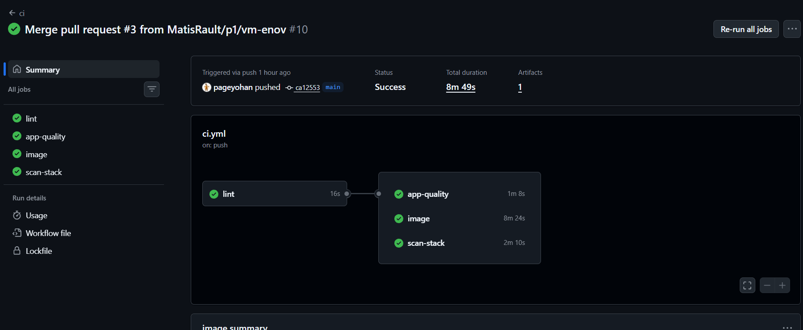

# CI/CD — image Rallly et pipeline

Porteur : P3 (Robin). Fichiers concernés : `.github/workflows/ci.yml`, `app/rallly/apps/web/Dockerfile`,
`scripts/smoke-test.sh`, `scripts/deploy.sh`, `compose.rallly.yml`.

## 1. Le code de Rallly : un import figé

- **Version** : Rallly **v4.15.4** (`app/rallly/UPSTREAM_VERSION`), importée le 2026-10-08 sans son
  historique Git ni ses workflows (`.git/` et `.github/` retirés).
- **Tag `rallly-import`** (commit `9253f0a`) : l'état exact de l'import. Tout ce qui a changé depuis
  dans `app/rallly/` est notre travail :
  ```bash
  git diff rallly-import -- app/rallly
  ```
- **Pas de mise à jour automatique** depuis upstream : on maîtrise ce qui tourne, et nos features
  ne cassent pas à cause d'un changement en amont.
- **Licence** : Rallly est sous **AGPL-3.0** (`app/rallly/LICENSE`, conservée). Le dépôt est public,
  donc le code de notre version modifiée est accessible à ses utilisateurs, comme l'exige l'AGPL.

## 2. L'image custom

Image publiée : **`ghcr.io/matisrault/rendu-dev-docker-robin-matis-yohan-projet-groupe-du-fond/rallly`**
(package **public**, lié au dépôt) — tags `main` (dernier `main` vert) et `sha-<commit>`.

Les modifications du Dockerfile upstream sont minimes et toutes commentées `# [projet]` :

| Point | Choix | Pourquoi |
|---|---|---|
| Image de base | `node:24.21.0` (build) et `node:24.21.0-slim` (exécution), **épinglées** | upstream utilise `node:24`, qui change à chaque release de Node : build non reproductible |
| Build multi-étapes | `turbo prune` → install → build → runner slim | l'image finale ne contient ni les sources ni les dépendances de build |
| Utilisateur | `USER nextjs` (non-root, déjà présent upstream) | un processus compromis n'est pas root dans le conteneur |
| `.dockerignore` | exclut `.git`, `.github`, `.env*`, `node_modules`, sorties de build | pas de secret ni de Go inutiles envoyés au build |
| Build args | `APP_VERSION=4.15.4`, `SELF_HOSTED=true` (mêmes que le workflow de release upstream) | sans `SELF_HOSTED`, on obtient l'image « cloud » avec facturation |
| Label OCI | `org.opencontainers.image.source` = URL du dépôt | relie le package GHCR au dépôt (il en hérite la visibilité publique) |

## 3. Le pipeline (`.github/workflows/ci.yml`)

Déclenché sur chaque PR, chaque push sur `main`, et à la main (`workflow_dispatch`).

```
lint ─┬─> app-quality : Biome + client Prisma + types TypeScript de app/rallly
      ├─> image : build ─> scan Trivy (SARIF) ─> smoke test de TOUTE la stack ─> push GHCR (main seulement)
      └─> scan-stack : Trivy des images tierces (Caddy, Authentik, Postgres, Mailpit, Garage…)
```

| Job | Ce qu'il vérifie |
|---|---|
| `lint` | secrets dans tout l'historique (gitleaks, `--redact`), `.env` généré par `scripts/gen-env.sh`, `docker compose config`, Caddyfile valide, aucun fichier en CRLF, shellcheck des scripts |
| `app-quality` | `pnpm install --frozen-lockfile`, `pnpm check` (Biome + règles de structure de Rallly), `pnpm type-check` |
| `image` | build avec cache GitHub Actions, scan Trivy HIGH/CRITICAL publié dans l'onglet Security, puis **démarrage de toute la stack avec l'image qui vient d'être construite** et `scripts/smoke-test.sh` : Rallly répond en HTTPS, l'OIDC Authentik est en place, la connexion par e-mail est refusée (SSO obligatoire), aucune base de données n'est exposée |
| `scan-stack` | Trivy des autres images de la stack (informatif, ne bloque pas) |

Choix importants :
- **L'image n'est poussée que si le smoke test passe** : `:main` ne contient jamais une image qui casse la stack.
- Les PR construisent et testent l'image **sans la pousser** (pas d'accès en écriture au registre depuis une PR).
- `concurrency` annule un run devenu obsolète quand on repousse sur la même branche.
- `permissions: contents: read` par défaut ; seul le job `image` reçoit `packages: write` et `security-events: write`.
- Bonne pratique non appliquée faute de temps : épingler les actions tierces par **SHA de commit** plutôt
  que par tag (des tags d'actions populaires ont déjà été compromis, cf. tj-actions/changed-files en 2025).

### Pipeline vert sur `main`



## 4. Résultats du scan de l'image

Trivy (vulnérabilités HIGH et CRITICAL) analyse chaque image construite. Les résultats sont publiés au
format SARIF dans l'onglet **Security → Code scanning** du dépôt.

État au 2026-10-26, image `:main` (Rallly 4.15.4 + nos features) : **7 CRITICAL, 83 HIGH** alertes ouvertes.

| Origine | Paquets | Lecture |
|---|---|---|
| Système Debian de `node:24.21.0-slim` | `perl-base`, `zlib1g`, `curl`/`libcurl4`, `util-linux` et ses bibliothèques, `ncurses`, `tar`, `gzip`, `libsystemd0`… | la grande majorité des alertes ; la plupart n'ont pas encore de correctif dans Debian, et ces outils ne sont pas appelés par l'application |
| Dépendances npm de Rallly | `next`, `fast-xml-parser`, `undici`, `brace-expansion`, `http-cache-semantics`, `ip-address` | corrigées upstream dans des versions plus récentes : à traiter en important une nouvelle version de Rallly |

Choix : le scan **n'échoue pas** le pipeline. Nous ne maintenons pas les dépendances de Rallly : bloquer sur
des CVE upstream empêcherait toute livraison. Le scan sert à rendre le risque visible. Pistes pour réduire la
surface : une base `distroless` (plus de shell ni d'outils système) et un import d'une version plus récente de Rallly.

## 5. Déploiement : option A (livraison continue)

La VM d'Énov est derrière le VPN NetBird : les runners hébergés par GitHub **ne peuvent pas** la joindre.

| Option | Principe | Retenue ? |
|---|---|---|
| **A** | La CI publie l'image ; sur la VM, `bash scripts/deploy.sh` (à la main ou par cron) | ✅ |
| B | Runner GitHub auto-hébergé sur la VM, job `deploy` sur push `main` | non : un runner sur un dépôt public est risqué (code de PR exécuté sur la VM) et c'est un service de plus à maintenir |
| C | Le job rejoint le VPN avec une setup key NetBird, puis SSH | non : il faut une setup key fournie par Énov, et ce serait un accès au VPN stocké dans GitHub |

**Pourquoi A** : simple, sûr (aucun accès entrant ni secret de la VM dans GitHub), et la CI garantit déjà
que l'image publiée démarre avec toute la stack. Le déploiement n'est pas déclenché par la CI : c'est de la
livraison continue, pas du déploiement continu.

`scripts/deploy.sh`, sur la VM :
1. `git pull --ff-only` : récupère les fichiers Compose, Caddy et les blueprints (la VM n'a pas besoin des sources de Rallly) ;
2. `docker compose pull` puis `up -d --remove-orphans` : tire la nouvelle image `:main` et redémarre ce qui a changé ;
3. si `proxy/Caddyfile` ou `config/garage.toml` a changé dans ce pull, `up -d --force-recreate` de `caddy` ou `garage`
   (voir les pièges ci-dessous) ;
4. `docker image prune -f` ;
5. `scripts/smoke-test.sh` sur le domaine de la VM, puis `docker compose ps`.

Pour l'automatiser, une ligne de cron sur la VM suffit, par exemple toutes les 15 minutes :
```
*/15 * * * * cd ~/Rendu-dev-docker-robin-matis-yohan-projet-groupe-du-fond && bash scripts/deploy.sh >> ~/deploy.log 2>&1
```

## 6. Pièges rencontrés

- **Bits exécutables perdus sous Windows** (`core.fileMode=false`) : `docker-start.sh` importé en 100644,
  l'image redémarrait en boucle avec une `SyntaxError` (le point d'entrée Node l'exécutait comme du JS).
  Le smoke test de la CI l'a détecté ; corrigé avec `git update-index --chmod=+x`.
- **Config montée en fichier unique jamais rechargée** (trouvé par P1 sur la VM, PR #9) : un bind mount
  de fichier suit l'inode ; `git pull` remplace le fichier, le conteneur garde l'ancien, et ni `up -d` ni
  `caddy reload` ne le voient. Conséquence réelle : Mailpit est resté accessible sans authentification.
  `deploy.sh` recrée donc `caddy` / `garage` quand leur fichier a changé. Limite : si `deploy.sh` échoue
  après le `git pull`, le relancer ne voit plus de changement ; dans ce cas,
  `docker compose up -d --force-recreate caddy garage`.
- **Contournement du SSO par code e-mail** : `EMAIL_LOGIN_ENABLED: "false"` (demandé par P2) masque le
  formulaire e-mail et désactive les mots de passe, mais l'API de connexion par code OTP restait ouverte :
  on obtenait une session avec un simple `curl`, sans passer par Authentik ni ses policies. Corrigé dans
  `app/rallly/apps/web/src/lib/auth.ts` (ces endpoints renvoient 403 quand la connexion e-mail est désactivée) et
  vérifié par le smoke test. Effet de bord assumé : la vérification d'e-mail des invités sur les pages
  d'événement (RSVP) n'est plus disponible.
- **Faux positifs gitleaks** dans le code de Rallly (clé de licence d'exemple, nom de fuseau horaire) :
  ajoutés à l'allowlist de `.gitleaks.toml`, chemin par chemin.
- **Build local impossible sur un PC de 8 Go** : `next build` dépasse 5 Go de RAM. La CI construit
  l'image ; pour tester une feature en local, on tire l'image `:main` de GHCR (`RALLLY_IMAGE` dans `.env`).
