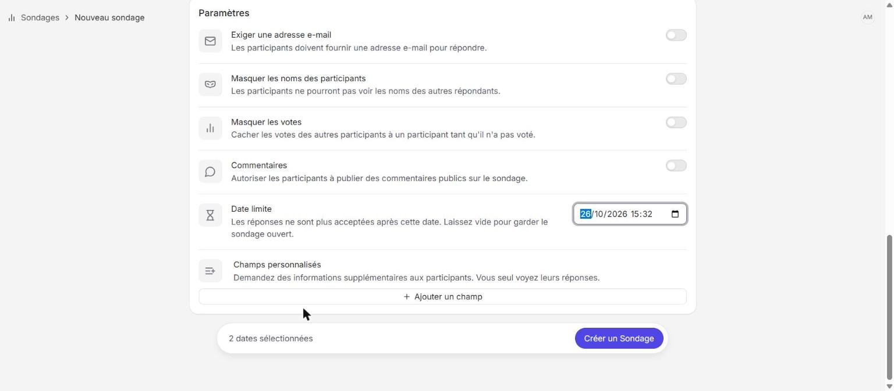
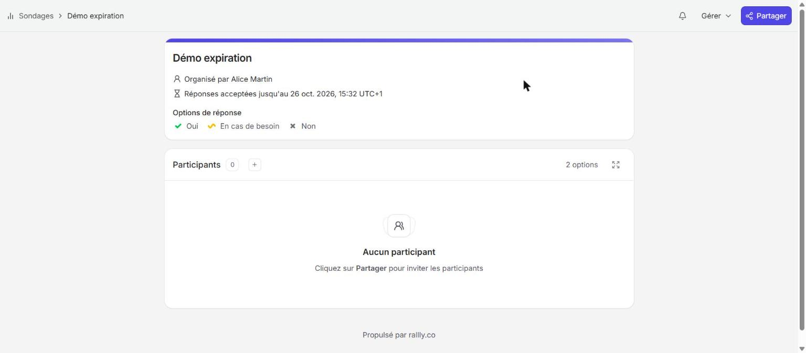
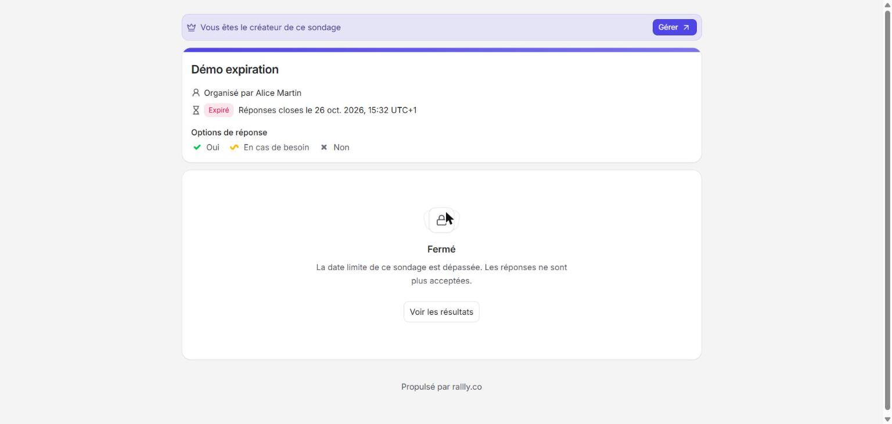
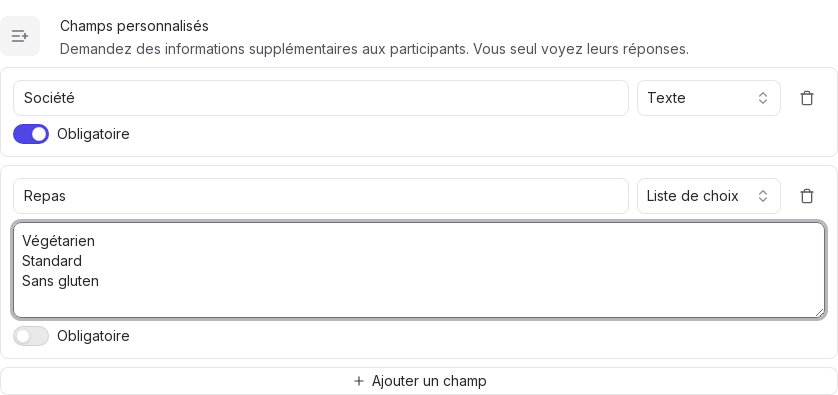
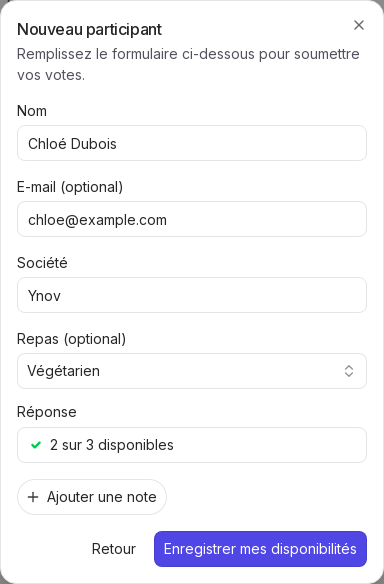
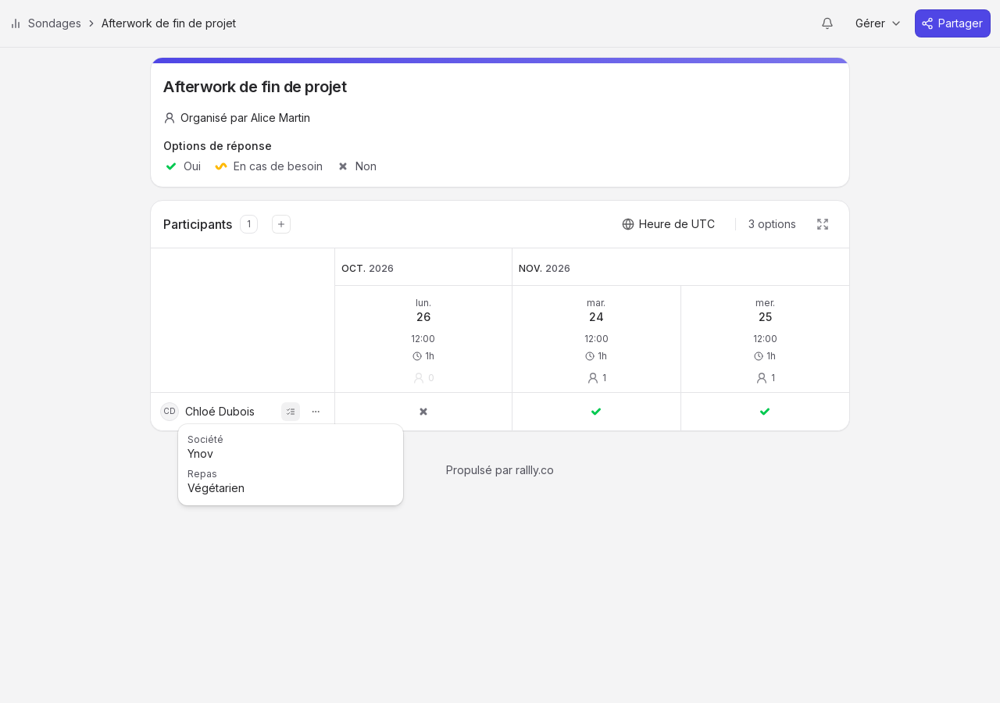

# Features ajoutées à Rallly

Chaque porteur écrit sa section. Le code ajouté se lit avec
`git diff rallly-import..main --stat -- app/rallly` ; chaque modification est repérée par
un commentaire `[projet]`.

## Catalogue #4 (P2) — expiration des sondages

Inspirée de la discussion Rallly [#134](https://github.com/lukevella/rallly/discussions/134)
(« Add (automatic) expiry option »).

- **Problème** : Rallly ne ferme un sondage que lorsque toutes ses dates sont passées, ou à la
  main. L'organisateur ne peut pas dire « je veux les réponses avant vendredi 18 h ». La colonne
  `deadline` existe dans le schéma, héritée d'une ancienne version, mais aucun code ne
  l'utilise.
- **Périmètre** :
  - à la création et dans les réglages, l'organisateur choisit une **date limite** facultative
    (refusée si elle est déjà passée à la création) ;
  - les votants voient « Réponses acceptées jusqu'au … » dans l'en-tête du sondage ;
  - après l'échéance, l'**API refuse** les nouveaux votes, la modification d'un vote et les
    invitations par e-mail. La règle est évaluée à chaque requête : elle tient même si aucune
    tâche planifiée ne tourne ;
  - l'interface affiche le sondage comme fermé, avec un badge « Expiré » ;
  - la tâche de maintenance existante `auto-close-polls` ferme aussi en base les sondages
    expirés (`closedReason: auto`) ;
  - repousser ou retirer la date rouvre un sondage fermé par l'échéance, s'il lui reste des
    dates à venir ;
  - interface en anglais et en français.
- **Hors périmètre** : suppression automatique (Rallly supprime déjà les sondages inactifs),
  rappel par e-mail avant l'échéance. Les commentaires restent ouverts, comme sur un sondage
  fermé dans Rallly.
- **Aucune migration** : la colonne `polls.deadline` existe déjà.

### Fichiers

| Fichier | Rôle |
|---|---|
| `features/poll/utils.ts` (+ `utils.test.ts`) | `isPollExpired`, `isPollAcceptingResponses`, conversion `datetime-local` |
| `trpc/routers/polls.ts` | `deadline` à la création, à la modification et en lecture ; réouverture |
| `trpc/routers/polls/participants.ts`, `polls/utils.ts` | Refus du vote et de la modification de vote |
| `features/poll/invite/mutations.ts` | Refus des invitations |
| `features/poll/mutations.ts` | `autoClosePolls` ferme aussi les sondages expirés |
| `features/poll/client.tsx` | Même règle côté client (formulaire de vote masqué) |
| `features/poll/components/poll-deadline.tsx`, `event-card.tsx`, `responsive-results.tsx` | Affichage |
| `features/poll/components/forms/poll-settings.tsx` (+ création, réglages) | Champ « Date limite » |

### Démo (1 min 15)

1. Créer un sondage avec une date limite dans 2 minutes : l'en-tête affiche
   « Réponses acceptées jusqu'au … ».
2. Voter en invité : accepté.
3. Après l'échéance, recharger la page : « Fermé — la date limite de ce sondage est
   dépassée », badge « Expiré », plus de formulaire de vote.
4. Appel API forgé (le vote rejoué depuis l'onglet Réseau du navigateur) : refusé par le
   serveur (`This poll has expired and no longer accepts responses`).
5. Dans les réglages, repousser la date : le sondage accepte de nouveau les votes.

### Captures (stack locale, image `rallly:main`)

| Réglage | Avant l'échéance | Après l'échéance |
|---|---|---|
|  |  |  |

Vérifié dans le navigateur : vote accepté avant l'échéance ; après, vote forgé par l'API
refusé (HTTP 400 `This poll has expired and no longer accepts responses`), modification du
vote refusée même pour la créatrice ; date repoussée → sondage rouvert.

---

## Catalogue #8 (P1) — réservation de créneaux

Inspirée de la discussion Rallly [#139](https://github.com/lukevella/rallly/discussions/139),
« Time slot booking ». Le plan la classait « difficile, à éviter sauf si attribuée » :
elle l'était.

### Le problème

Un sondage Rallly ordinaire demande des **disponibilités** : plusieurs personnes
peuvent cocher le même créneau, et l'organisateur tranche ensuite. Pour un rendez-vous
individuel — entretien, soutenance, créneau avec un professeur — ce n'est pas ce qu'on
veut : le créneau doit être **attribué** à la première personne qui le prend.

Le demandeur de la discussion décrit exactement ce besoin, et un autre utilisateur le
confirme en 2024 : dans son école, deux personnes avaient réservé le même créneau
individuel.

### Le périmètre

Un drapeau **mode réservation** sur le sondage. Quand il est actif, deux règles :

1. **un participant ne réserve qu'un créneau** ;
2. **un créneau n'est pris que par un participant**.

`ifNeedBe` (« si nécessaire ») est refusé : la notion n'a pas de sens quand un créneau
est attribué à une personne et une seule.

Choix de modélisation : un **booléen** `Poll.bookingMode`, et non une valeur de
`PollKind`. `PollKind` décrit la **nature des options** (`date` ou `time`), pas les
règles de vote ; en faire un `PollKind` aurait été sémantiquement faux et se serait
propagé dans tout le code de rendu.

### Le point difficile : deux personnes, le même créneau, la même seconde

La règle n°2 porte sur un **état partagé**. L'implémentation naïve — compter les
réservations existantes puis écrire — ne tient pas : PostgreSQL est en isolation
**READ COMMITTED** par défaut, donc deux transactions concurrentes lisent toutes les
deux « zéro réservation » avant que l'une n'écrive. Le créneau part deux fois, et
c'est précisément le bug décrit dans la discussion.

La règle est donc appliquée sous **verrou pessimiste**, dans la transaction qui écrit
les votes :

```sql
SELECT id FROM options WHERE id IN (...) ORDER BY id FOR UPDATE
```

La seconde transaction attend la fin de la première, voit sa réservation, et la
refuse avec un `CONFLICT`. `ORDER BY id` fixe l'ordre de verrouillage, ce qui évite
l'interblocage quand deux requêtes concurrentes portent sur plusieurs créneaux.

### Contrôle côté serveur, pas seulement dans l'interface

Les deux règles sont appliquées dans `participants.add` **et** dans
`participants.update`. Le second n'est pas du zèle : sans lui, il suffirait de créer
une réponse vide puis de la modifier pour contourner le contrôle.

L'interface est alignée sur la règle plutôt que chargée de l'appliquer : en mode
réservation, le bouton de vote n'alterne qu'entre *réservé* et *non réservé*, donc il
ne propose jamais un choix que le serveur rejettera.

### Fichiers

| Fichier | Rôle |
|---|---|
| `packages/database/prisma/models/poll.prisma` + migration `20261116120000_booking_mode` | champ `bookingMode` |
| `apps/web/src/features/poll/booking/utils.ts` | règles pures, sans accès base |
| `apps/web/src/features/poll/booking/utils.test.ts` | 7 tests unitaires |
| `apps/web/src/features/poll/booking/mutations.ts` | règle concurrente et verrou |
| `apps/web/src/trpc/routers/polls/participants.ts` | application dans `add` et `update` |
| `apps/web/src/trpc/routers/polls.ts` | réglage à la création et à la modification |
| `apps/web/src/features/poll/components/forms/poll-settings.tsx` | l'interrupteur |
| `apps/web/src/features/poll/components/vote-selector.tsx` | cycle de vote restreint |

### Démo (1 min 15)

1. Créer un sondage avec 3 créneaux, activer **Mode réservation** dans les réglages.
2. Avec `alice` : réserver le créneau 1. Accepté.
3. Avec `admin` : tenter le créneau 1. **Refusé**, message « Already booked ».
4. Preuve côté API, sans passer par l'interface :

```bash
curl -ksS -X POST "https://rallly.<domaine>/api/trpc/polls.participants.add" \
  -H 'content-type: application/json' \
  -d '{"json":{"pollId":"<id>","name":"Mallory","votes":[
        {"optionId":"<creneau-1>","type":"yes"},
        {"optionId":"<creneau-2>","type":"yes"}]}}'
# -> 400 : "you may book at most 1 slot (received 2)"
```

C'est ce dernier point qui compte : la règle tient **même quand l'interface est
contournée**.

### Limites assumées

- **La garantie dépend du chemin d'écriture.** Le verrou protège toutes les écritures
  qui passent par l'API. Une écriture directe en base la contournerait. Un index
  unique partiel sur `votes` serait plus fort, mais il porterait sur **toute** la
  table et casserait les sondages ordinaires, où plusieurs personnes doivent pouvoir
  répondre « oui » au même créneau. La condition « seulement si le sondage est en mode
  réservation » n'est pas exprimable dans un index sur `votes` seul.
- **Les créneaux déjà pris ne sont pas encore grisés** dans la grille de vote : la
  tentative est refusée au moment de l'envoi, avec un message clair, plutôt
  qu'empêchée d'avance. Fonctionnellement correct, perfectible côté confort.
- **« Un seul créneau par participant » reste une règle douce**, comme le note la
  discussion d'origine : sans authentification obligatoire, rien n'empêche de créer
  deux réponses sous deux noms. Le SSO Authentik et `EMAIL_LOGIN_ENABLED=false`
  réduisent la fenêtre, ils ne la ferment pas.
## Champs personnalisés pour les votants (libre) — Robin (P3)

- **Problème / issue Rallly d'origine** : [discussion #201](https://github.com/lukevella/rallly/discussions/201).
  L'organisateur ne peut demander aux votants que leur nom (et éventuellement leur e-mail). Pour organiser un
  événement, il a souvent besoin d'autre chose : société, régime alimentaire, taille de t-shirt…
- **Périmètre** :
  - à la création ou dans les réglages d'un sondage, l'organisateur ajoute jusqu'à **5 champs** : texte libre,
    e-mail ou liste de choix, chacun obligatoire ou non ;
  - le votant les remplit dans le formulaire de vote ;
  - les réponses ne sont visibles **que par l'organisateur** (bouton à côté de chaque participant) et
    sont ajoutées en colonnes à l'**export CSV** ;
  - interface traduite en français et en anglais ;
  - hors périmètre : modifier ses réponses après le vote, champs numériques ou dates, statistiques sur les réponses.
- **Implémentation** ([PR #5](https://github.com/MatisRault/Rendu-dev-docker-robin-matis-yohan-projet-groupe-du-fond/pull/5)) :
  - *Schéma Prisma* : `Poll.customFields` (JSON, la définition des champs) et `Participant.customAnswers`
    (JSON, les réponses), migration `20261026120000_custom_participant_fields` (deux colonnes avec valeur
    par défaut : sans impact sur les sondages existants) ;
  - *API (tRPC)* : `polls.make`, `polls.modify`, `polls.get` et `polls.duplicate` gèrent les champs ;
    `polls.participants.add` **revalide côté serveur** (champ obligatoire, format e-mail, choix dans la liste,
    réponses à des champs inconnus ignorées, tailles bornées) ; `participants.list` ne renvoie les réponses
    qu'à l'organisateur ;
  - *Validation* : `apps/web/src/features/poll/custom-fields/` (schémas zod partagés client/serveur,
    12 tests unitaires vitest) ;
  - *UI* : éditeur de champs dans les réglages du sondage, champs dans la fenêtre de vote, popover des
    réponses (vues bureau et mobile), colonnes CSV.
  - Au passage : l'option « Exiger l'e-mail des participants » n'était vérifiée que dans le navigateur ;
    elle l'est maintenant aussi côté serveur.
- **Démo (1 min)** :
  1. Créer un sondage, ajouter les champs « Société » (texte, obligatoire) et « Repas » (liste : Végétarien, Standard) ;
  2. Ouvrir le lien d'invitation en navigation privée, voter sans remplir « Société » → refusé ; le remplir → accepté ;
  3. Revenir en organisateur : bouton « réponses » à côté d'Alice, puis export CSV avec les colonnes Société et Repas.
- **Captures** (stack locale complète, image `rallly:main`, organisatrice `alice` connectée par le SSO Authentik) :

  | Éditeur (réglages du sondage) | Formulaire de vote | Réponses (vue organisatrice) |
  |---|---|---|
  |  |  |  |
- **Limites** :
  - les réponses sont stockées en JSON : pas de requête SQL ou de statistique par champ ;
  - supprimer un champ masque ses réponses (elles restent en base) ;
  - un votant ne peut pas modifier ses réponses une fois son vote envoyé.
